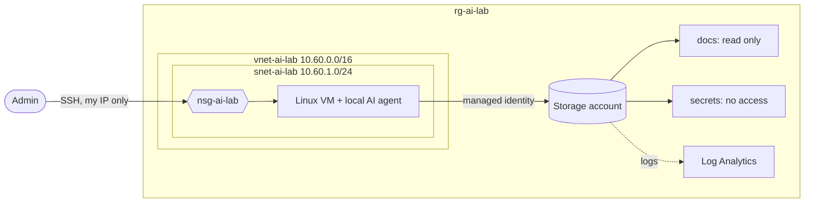

# Azure AI IAM Lab

A hands-on lab for securing an AI agent's identity in Azure, built with Terraform.

The goal: run a local AI agent on a Linux VM, give it a **managed identity** with the
least privilege it needs, then attack it with prompt injection and prove that the
identity, not the model, is what stops it doing damage.

> Built step by step as part of studying for the SC-500 (Cloud and AI Security Engineer) exam.

## Why this matters

AI agents are starting to act on their own: reading files, calling APIs, deleting things.
If an agent can be tricked by text it reads (prompt injection), the only reliable limit is
**what its identity is allowed to do**. This lab treats the model as untrusted and makes
the permissions the security boundary. It maps to:

- **OWASP Top 10 for Agentic Applications:** ASI02 Tool Misuse, ASI03 Identity & Privilege Abuse
- **OWASP LLM Top 10:** LLM06 Excessive Agency
- **Zero Trust:** least privilege, assume breach

## Architecture



## Security decisions

| Decision | Why |
|---|---|
| Subscription ID and admin IP passed in as variables (`TF_VAR_*`) | Nothing personal or sensitive is written into the code |
| State files and plans in `.gitignore` | `terraform.tfstate` holds resource IDs and IPs in plain text |
| Provider version pinned with `.terraform.lock.hcl` | Every run uses the same provider build, and it's checked against a known hash |
| NSG allows SSH from a single `/32` | An internet-facing SSH port gets brute-forced within minutes |
| Standard SKU public IP | Closed by default, so only traffic the NSG allows gets through |

## Usage

Requirements: Terraform, Azure CLI (`az login`), an Azure subscription.

```bash
export TF_VAR_subscription_id="<your-subscription-id>"
export TF_VAR_admin_ip="$(curl -s ifconfig.me)"

terraform init
terraform fmt && terraform validate
terraform plan -out tf.plan
terraform apply tf.plan
```

Tear everything down when you're finished, so it stops costing money:

```bash
terraform destroy
```

## Stack

Terraform · azurerm provider 4.x · Azure (VNet, NSG, VM, Managed Identity, Storage, Log Analytics) · Linux
